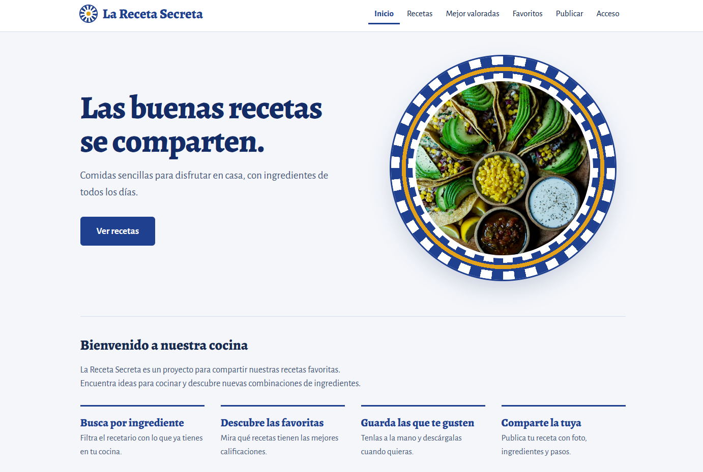
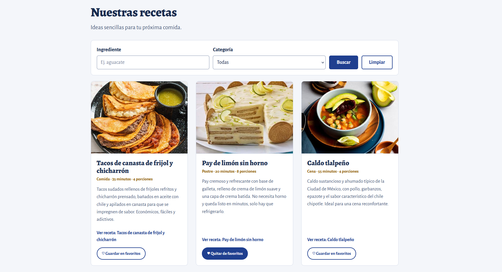
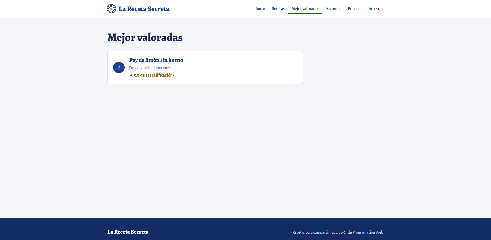
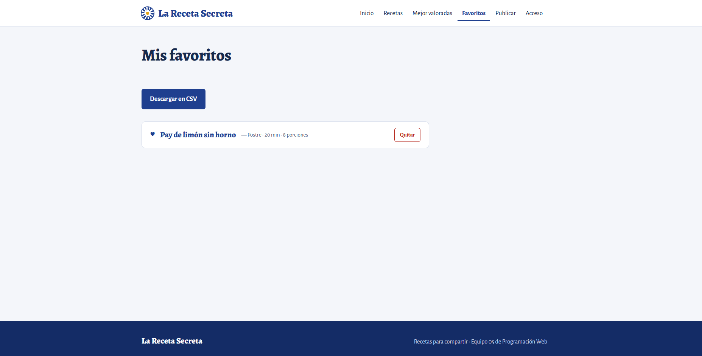
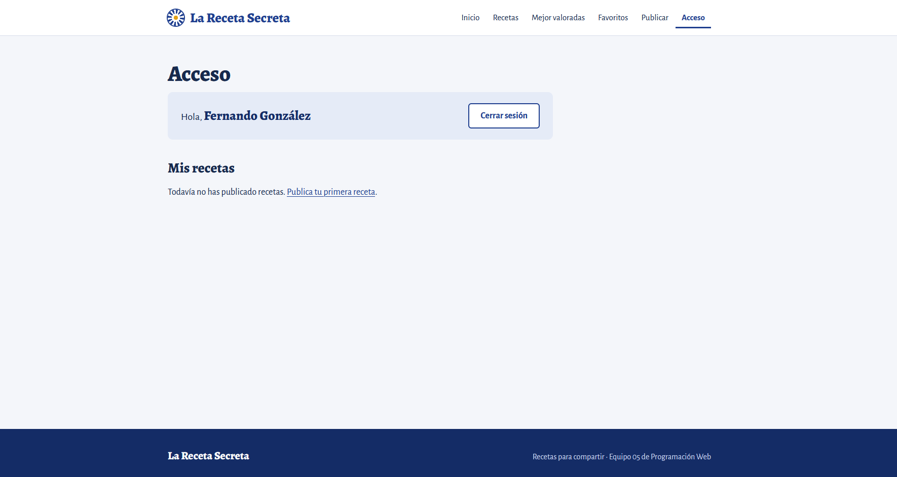
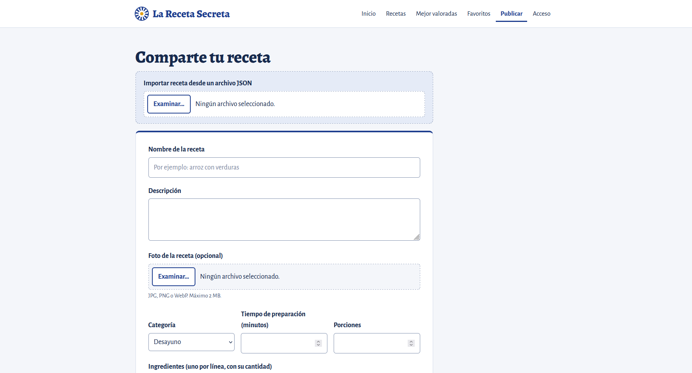
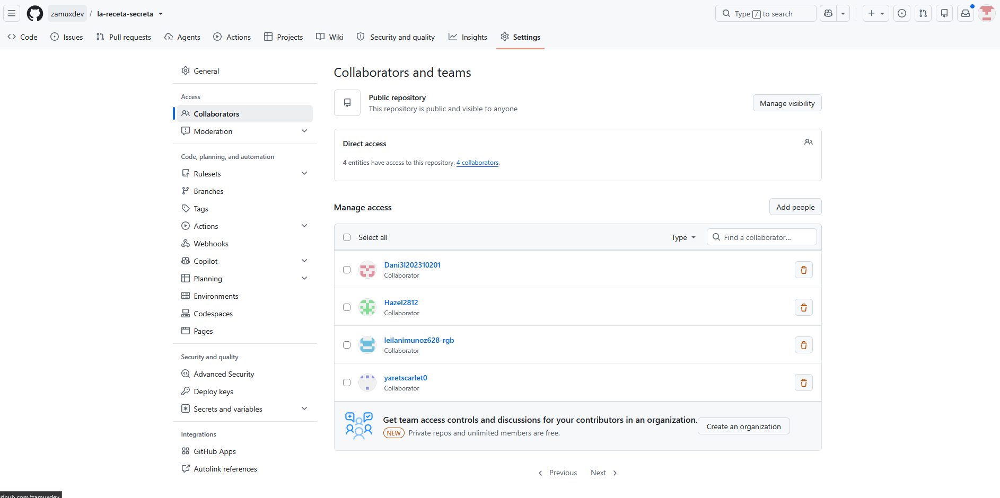
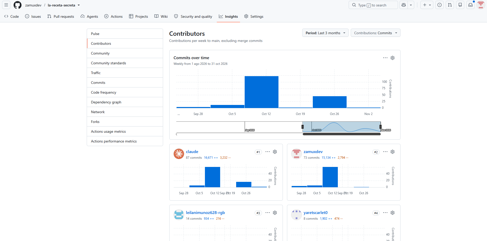

# Segundo parcial: programación del lado del cliente y del servidor

Equipo 05 · Programación Web (AEB-1055) · La Receta Secreta

Este documento reúne lo que pide el segundo parcial y explica cómo trabajamos para lograrlo. Todo lo que se afirma aquí se puede comprobar en el repositorio: en el código, en el historial de git o en los Pull Requests de GitHub.

| Tema | Qué pide el parcial | Dónde está en este documento |
|---|---|---|
| Tema 3: lado del cliente | Búsqueda por ingrediente o tipo, calificación y favoritos, con validación en el cliente e interfaz dinámica, y documentación de las decisiones técnicas | [Sección 2](#2-tema-3-programación-del-lado-del-cliente) |
| Tema 4: lado del servidor | Guardar recetas, calificaciones y favoritos por usuario, procesar publicaciones, servir las mejor valoradas, resolver conectividad y manejo de datos, y documentar las decisiones técnicas | [Sección 3](#3-tema-4-programación-del-lado-del-servidor) |
| Forma de trabajo | Cómo nos organizamos con git y con agentes de programación | [Secciones 4 y 5](#4-cómo-trabajamos-con-git-y-github) |

## 1. El proyecto en una página

La Receta Secreta es un recetario social: se publican, buscan, guardan y califican recetas.

- **Interfaz (`frontend/`):** HTML, CSS y JavaScript sin frameworks. Es una sola página (`index.html`) con pantallas que cambian según la URL (`#/recetas`, `#/favoritos`, `#/publicar`...).
- **Servidor (`backend/`):** API REST en C# con ASP.NET Core (.NET 10), Entity Framework Core y PostgreSQL, que corre con Docker.
- **Contrato (`docs/10-contrato-api.md`):** define rutas, campos y errores. La interfaz y el servidor se construyeron contra ese documento, así que cada lado pudo avanzar sin esperar al otro.

### Quién hizo qué

| Persona | Cuenta de GitHub | Módulo | Requisitos |
|---|---|---|---|
| Hazel Martínez | `Hazel2812` | Búsqueda | RF-03, RF-04, RF-05 |
| Brandon Aguilar | `Dani3l202310201` | Favoritos | RF-15, RF-16, RF-17, RF-23 |
| Leilani Muñoz | `leilanimunoz628-rgb` | Calificaciones | RF-18 a RF-22 |
| Yaret Juárez | `yaretscarlet0` | Acceso y publicar | RF-06 a RF-14 |
| Fernando González | `zamuxdev` | Servidor, base de datos, cliente de la API, enrutador, catálogo, contrato, CI y revisión de PRs | Todos |

## 2. Tema 3: programación del lado del cliente

### 2.1 Cómo se descompuso el problema

El parcial pide "descomponer el problema en partes manejables". Lo hicimos en tres capas, y cada persona del equipo tomó una parte de la capa de módulos:

1. **Base común (Fernando):**
   - `api.js` es el único archivo que habla con el servidor. Los módulos llaman funciones como `api.listarRecetas({ categoria, ingrediente })` o `api.calificar(id, puntos)` y nunca usan `fetch` directo.
   - `app.js` es el enrutador: muestra la pantalla según la URL y avisa con el evento `pantalla-mostrada`.
   - `catalogo.js` dibuja la galería y el detalle de la receta, y avisa con `tarjetas-dibujadas` y `receta-mostrada`.
2. **Módulos (uno por persona):** `busqueda.js`, `favoritos.js`, `calificaciones.js`, `acceso.js` y `publicar.js`. Cada uno tiene su propio CSS y su documento de decisiones.
3. **Puntos de conexión:** los módulos no se llaman entre sí. Se coordinan con **eventos** en `document` y con **ranuras**, que son huecos vacíos en el HTML que cada módulo llena.

| Evento | Lo emite | Lo usan |
|---|---|---|
| `pantalla-mostrada` | `app.js` | Favoritos, Calificaciones, Acceso, Publicar |
| `tarjetas-dibujadas` | `catalogo.js` | Favoritos (botón en cada tarjeta), Búsqueda (mensaje sin resultados) |
| `receta-mostrada` | `catalogo.js` | Favoritos (botón en el detalle), Calificaciones (estrellas) |
| `sesion-cambiada` | `api.js` | Todos los que cambian según haya sesión o no |

**Por qué así:** cinco personas que casi no programaban iban a trabajar al mismo tiempo. Con un archivo por módulo y comunicación por eventos, casi nunca se editaron los mismos archivos y hubo un solo conflicto de git en todo el proyecto (el de la rama de Búsqueda, que se resolvió antes de unirla).

### 2.2 Búsqueda por ingrediente o tipo de comida (Hazel)

- Campo "Ingrediente", selector "Categoría" y botones "Buscar" y "Limpiar". Los dos filtros se combinan.
- Las categorías del selector vienen del servidor (`api.listarCategorias()`), no están escritas a mano.
- Al buscar se llama a `catalogo.cargar({ categoria, ingrediente })`, que vuelve a dibujar la galería sin recargar la página.
- Si no hay resultados, aparece un mensaje con lo que se buscó (RF-05) en lugar de una pantalla vacía.
- Validación: `trim()` quita los espacios de más y no se busca con todo vacío. Es un `<form>`, así que Enter también busca.

### 2.3 Calificaciones (Leilani)

- En el detalle de la receta hay cinco estrellas para calificar de 1 a 5, cambiar la calificación o quitarla. El promedio y el total se actualizan sin recargar.
- Reglas en el cliente: sin sesión se invita a entrar, y en una receta propia no se muestran las estrellas (el servidor lo prohíbe de todos modos).
- Las estrellas son `<button>` reales con `aria-label` ("Calificar con 3 estrellas"), miden 44 px para tocarlas con el dedo y se usan con el teclado.
- Pantalla "Mejor valoradas" con la lista ordenada por promedio.

### 2.4 Favoritos (Brandon)

- Botón "Guardar en favoritos" en cada tarjeta de la galería y en el detalle. Usa `aria-pressed` para que un lector de pantalla diga si está activo.
- Pantalla "Mis favoritos" con botón "Quitar" y botón "Descargar en CSV" (RF-23).
- Sin sesión, el botón muestra un aviso con enlace a Acceso. Al cerrar o abrir sesión, los botones se actualizan solos (evento `sesion-cambiada`).

### 2.5 Acceso y publicar, con validación de formularios (Yaret)

- Registro e inicio de sesión, saludo con el nombre de quien entró y "Cerrar sesión".
- "Mis recetas" dentro de Acceso, con editar (`#/publicar/<id>`) y borrar.
- El formulario "Publicar" se valida **antes** de enviarse (`validarReceta` en `publicar.js`): nombre hasta 100 caracteres, descripción hasta 350, categoría válida, tiempo de 1 a 1440 minutos, porciones de 1 a 100, al menos un ingrediente y un paso, y foto JPG, PNG o WebP de máximo 2 MB. Los límites son los mismos que valida el servidor.
- Cada error aparece junto a su campo. Si el servidor rechaza algo, sus mensajes (`error.errores`) también se ponen junto al campo que corresponde.
- También se puede importar una receta desde un archivo JSON, que pasa por la misma validación.

| Acceso con sesión | Formulario Publicar |
|---|---|
|  |  |

### 2.6 Reglas que siguió todo el código del cliente

Estas reglas están en `AGENTS.md` y el CI revisa automáticamente las que se pueden revisar solas:

- **Seguridad contra XSS:** nunca se inserta texto del usuario con `innerHTML`; se usa `textContent` o `createElement`.
- **Aislamiento:** cada módulo va envuelto en `(() => { ... })();` para que sus variables no choquen con las de otros.
- **Accesibilidad:** cada campo con `label`, cada imagen con `alt`, botones reales, foco visible y mensajes con `role="status"` o `aria-live`.
- **Estados de carga y error:** mientras algo carga se ve "Cargando..."; si falla, se muestra `error.textoParaUsuario()` y nunca una pantalla en blanco.
- **Diseño adaptable:** se probó en escritorio y en celular (375 px).

### 2.7 Documentación de las decisiones técnicas (cliente)

Cada responsable tiene su documento, que responde qué hace el módulo, qué archivos tiene, qué se decidió y por qué, cómo se prueba y qué falta:

- [`docs/decisiones/busqueda.md`](decisiones/busqueda.md)
- [`docs/decisiones/favoritos.md`](decisiones/favoritos.md)
- [`docs/decisiones/calificaciones.md`](decisiones/calificaciones.md)
- [`docs/decisiones/acceso-publicar.md`](decisiones/acceso-publicar.md)

## 3. Tema 4: programación del lado del servidor

### 3.1 Arquitectura

| Parte | Archivo o carpeta | Para qué |
|---|---|---|
| Arranque y configuración | `Program.cs` | Base de datos, autenticación con JWT, CORS, mensajes de error en español |
| Controladores | `Controllers/` | `Recetas`, `Categorias`, `Auth`, `Favoritos`, `Calificaciones` |
| Modelo de datos | `Models/Entidades.cs`, `Data/RecetaDbContext.cs` | Tablas y sus reglas |
| DTOs | `Dtos/` | Lo que entra y sale por la API, separado de las entidades |
| Validaciones | `Validaciones/ValidadorFoto.cs` | Revisa el formato real y el tamaño de la foto |
| Exportación | `Exportacion/Exportador.cs` | JSON, XML y CSV |
| Migraciones | `Migrations/` | Crean la base al arrancar |
| Pruebas | `RecetaSecreta.Api.Tests/` | 52 pruebas con xUnit contra un PostgreSQL real |

### 3.2 Persistencia por usuario

| Tabla | Clave | Regla importante |
|---|---|---|
| `Usuarios` | `Id` | El correo es único. La contraseña se guarda como hash (`PasswordHasher`), nunca en texto plano. |
| `Recetas` | `Id` | `AutorId` liga cada receta publicada con quien la publicó (RF-13). |
| `Ingredientes` | `Id` | Se borran junto con su receta (cascada). |
| `Favoritos` | `(UsuarioId, RecetaId)` | La clave compuesta impide guardar dos veces la misma receta. |
| `Calificaciones` | `(UsuarioId, RecetaId)` | Una calificación por persona y receta (RF-20), y una restricción `CHECK` en la base obliga a que los puntos estén entre 1 y 5. |
| `Categorias` | `Id` | Nombre único. No se puede borrar una categoría que tenga recetas. |

**Decisión:** las reglas importantes están en la base de datos, no solo en el código. Así, aunque alguien mande peticiones a mano o haya un error en la interfaz, la base no acepta datos inválidos.

### 3.3 Procesar publicaciones

- `POST /api/recetas` exige sesión (`[Authorize]`) y liga la receta a su autor.
- `RecetaCrear` valida los campos con atributos (`[Required]`, `[StringLength]`, `[Range]`) y responde con el formato de errores del contrato: claves en `camelCase` y mensajes en español, para que la interfaz los ponga junto a cada campo.
- `ValidadorFoto` revisa el contenido real del archivo (no solo la extensión) y que no pase de 2 MB.
- `PUT` y `DELETE /api/recetas/{id}` solo los puede usar el autor (403 si es de otra persona). `GET /api/recetas/mias` lista las propias.

### 3.4 Calificaciones, favoritos y mejor valoradas

- `PUT /api/recetas/{id}/calificacion` crea o reemplaza la calificación; `DELETE` la quita. Calificar la receta propia responde 403.
- Responden con el promedio, el total y la calificación del usuario, para que la interfaz se actualice sin hacer otra petición.
- **El promedio no se guarda:** se calcula en la base cada vez. Así nunca queda desfasado.
- `GET /api/recetas/mejor-valoradas?limite=10` ordena por promedio, desempata por número de votos y luego por fecha. Solo incluye recetas con al menos una calificación.
- `GET`, `PUT` y `DELETE /api/favoritos` manejan la lista de cada usuario. `GET /api/favoritos/exportar` la descarga en CSV.

### 3.5 Conectividad y manejo de datos

Estos son los problemas concretos que tuvimos que resolver:

| Problema | Cómo se resolvió |
|---|---|
| La interfaz y la API corren en orígenes distintos durante el desarrollo | CORS en desarrollo, exponiendo `Content-Disposition` para que la interfaz lea el nombre del archivo exportado. En el servidor publicado la API sirve la interfaz desde `wwwroot`, así comparten sitio y no hace falta CORS. |
| El servidor no responde o no hay internet | `api.js` atrapa el fallo y lanza un `ErrorApi` con estado 0 y el mensaje "No se pudo conectar con el servidor. Revisa tu conexión e inténtalo de nuevo." |
| La sesión vence o el token deja de ser válido | Si el servidor responde 401, `api.js` cierra la sesión local y emite `sesion-cambiada` con `{ motivo: 'vencida' }`. |
| El token sigue vivo pero la cuenta ya no existe | El servidor revisa que el usuario exista antes de calificar y responde 401 si no. |
| Dos peticiones calificando a la vez | Si la base reporta una clave duplicada, se actualiza el valor en lugar de fallar. |
| JSON con tipos equivocados o parámetros inválidos | `Program.cs` traduce esos errores a mensajes en español con la clave del campo. |
| Poner la base en marcha sin pasos a mano | Al arrancar se aplican las migraciones y se cargan las recetas de ejemplo y las cuentas precargadas. |
| Intercambio de datos | JSON para la API, XML y JSON para descargar una receta, CSV para los favoritos (RF-23). |

### 3.6 Pruebas y documentación (servidor)

- `dotnet test backend/RecetaSecreta.Api.Tests` corre 52 pruebas (`[Fact]` y `[Theory]`) contra una base `receta_secreta_pruebas` que se crea de cero en cada corrida. Cubren autenticación, recetas, favoritos, calificaciones, exportación y la validación de la foto.
- El CI las corre en cada Pull Request con un PostgreSQL temporal.
- Las decisiones del servidor están en [`docs/05-arquitectura.md`](05-arquitectura.md) y en el [contrato de la API](10-contrato-api.md). El servidor no tiene un documento en `docs/decisiones/` como los módulos de la interfaz; sus decisiones quedaron en esos dos documentos y en las descripciones de los PRs #1 a #10.

## 4. Cómo trabajamos con git y GitHub

### 4.1 Reglas

Las reglas están escritas en [`AGENTS.md`](../AGENTS.md) (sección 3) y en [`TASKS.md`](../TASKS.md):

- **Nadie sube cambios directo a `main`**, tampoco Fernando. Cada tarea va en su propia rama.
- Ramas con el formato `modulo/descripcion-corta`, por ejemplo `calificaciones/estrellas-calificar` o `acceso/mis-recetas`.
- **Una tarea = una rama = un Pull Request.** Fernando revisa y une; nadie une su propio PR, salvo Fernando los suyos.
- **Cada quien solo toca los archivos de su módulo.** Los archivos compartidos (`index.html`, `estilos.css`) tienen reglas: cada quien edita solo el bloque de su pantalla.
- Si hay un conflicto de git, no se resuelve a ciegas: se avisa a Fernando.

### 4.2 El ciclo de cada tarea

1. `git switch main` y `git pull` para estar al día.
2. `git switch -c modulo/tarea` para crear la rama.
3. Trabajar con el agente y probar en el navegador.
4. `git commit` con un mensaje que dice qué cambió, y `git push -u origin modulo/tarea`.
5. Abrir el Pull Request hacia `main`.
6. El CI revisa el PR. Fernando lo prueba, pide cambios si hace falta y lo une.

### 4.3 Revisión automática (CI)

`.github/workflows/ci.yml` corre en cada Pull Request dos revisiones:

- **Revisión de la interfaz** (`.github/scripts/revisar-interfaz.sh`): que no haya `fetch` fuera de `api.js`, ni `console.log`, ni `innerHTML`; que cada módulo esté envuelto en `(() => { ... })();`; que las imágenes tengan `alt`; que el JavaScript no tenga errores de sintaxis, y que no se suban `bin/`, `obj/`, `node_modules/` ni PDFs.
- **Pruebas del servidor:** compila la API y corre las 52 pruebas.

Además, `.github/workflows/desplegar.yml` publica la API y la interfaz en Azure App Service cada vez que algo llega a `main`, en cuanto existan en el repositorio la variable `AZURE_WEBAPP_NAME` y el secreto con el perfil de publicación.

### 4.4 Ejemplos reales de revisión

- **PR #15, Favoritos (Brandon):** Fernando pidió cambios. Faltaban `role="status"` y `aria-live` en los mensajes, un error se ocultaba en silencio y el documento se contradecía. Brandon subió dos commits con las correcciones y el PR se aprobó y se unió.
- **PR #17 y #18, Calificaciones (Leilani):** se unió el módulo, y en la revisión se encontraron dos detalles (el resaltado de las estrellas al pasar el mouse y el estado al fallar la recarga de sesión), que se corrigieron en el PR #18.
- **PR #23, Búsqueda (Hazel):** antes de unirlo se corrigió en su misma rama: el selector mostraba `[object Object]`, el mensaje sin resultados nunca salía, se había subido un submódulo por error y el documento estaba en otra carpeta. Se le dejó en el PR la explicación de cada corrección y el "Resumen para defender". También fue el único PR con un conflicto de git, que se resolvió antes de unirlo.
- **PR #19 a #22, Acceso y publicar (Yaret):** cuatro PRs, uno por grupo de tareas (Y1 a Y5, Y6 y Y7, Y9 a Y11, Y8).

### 4.5 Los números del repositorio

Datos de `main` al 6 de noviembre de 2026:

| Dato | Valor |
|---|---|
| Pull Requests | 29, todos unidos |
| Commits sin contar uniones | 103 |
| Commits de unión (uno por PR, más la resolución del conflicto de Búsqueda) | 30 |
| Periodo | Del 2 de octubre al 4 de noviembre de 2026 |

Commits por autor en `main` (sin uniones):

| Autor | Commits |
|---|---|
| Fernando (`zamuxdev`) | 63 |
| Leilani | 14 |
| Claude (commits hechos directamente por el agente) | 11 |
| Yaret | 8 |
| Brandon (`Dani3l202310201`) | 6 (son 3 cambios: los mismos 3 commits quedaron dos veces en el historial) |
| Hazel | 1 |

**Cómo leer la gráfica de GitHub.** GitHub pone a "claude" en primer lugar con 87 commits porque cuenta también los commits donde Claude aparece como coautor (la línea `Co-Authored-By` al final del mensaje), y no solo los que Claude hizo directamente. Por eso sus números se enciman con los de Fernando y los de Yaret. Las cifras de la tabla de arriba son por autor y no se repiten.

**Lo que se ve en el historial, sin adornos:**

- El trabajo se concentró en dos semanas. La del 12 de octubre fue el servidor, el contrato y las reglas del equipo. La del 26 de octubre fueron los cuatro módulos de la interfaz, que se unieron entre el 29 y el 31 de octubre.
- Los PRs del servidor (#1 a #14) los abrió y los unió Fernando, la mayoría en menos de un minuto. Ahí no hubo una revisión de otra persona; lo que los respalda es el CI y las pruebas automatizadas.
- La rama de Favoritos (`favoritos-brandon`) y la de Búsqueda (`modulo-busqueda`) no siguieron el formato `modulo/descripcion-corta`.

## 5. Cómo usamos los agentes de programación

### 5.1 La idea

El equipo casi no sabía programar, así que el código lo escribieron agentes de programación y cada persona dirigió y revisó el de su módulo. Para que varios agentes trabajaran en el mismo repositorio sin romper nada, se escribieron reglas que los agentes leen solos:

- **[`AGENTS.md`](../AGENTS.md):** qué es el proyecto, qué archivos son de cada módulo, cómo se conectan los módulos, reglas de git, reglas de código y cómo correr el proyecto. Es un formato que leen varios agentes, no solo uno.
- **`CLAUDE.md`:** solo contiene `@AGENTS.md`, para que Claude Code lea las mismas reglas.
- **[`TASKS.md`](../TASKS.md):** las tareas de cada persona, en orden y con un "Listo cuando..." que sirve de prueba.
- **El contrato de la API:** los agentes no pueden inventar campos ni endpoints; si algo falta, primero se cambia el contrato.

### 5.2 Cómo se trabajó con el agente en cada tarea

1. La persona abre su agente en la carpeta del proyecto y le dice quién es y cuál es su módulo.
2. El agente lee `AGENTS.md` y `TASKS.md`, escribe el código de la tarea y lo prueba en el navegador.
3. Al terminar entrega un **"Resumen para defender"** de 4 a 6 líneas: qué hace, qué archivos tocó, cómo se conecta, qué decidió y cómo probarlo. La persona lo lee para poder explicarlo en la presentación, y el mismo resumen se copia en `docs/decisiones/<modulo>.md`.
4. La persona sube la rama y abre el PR, y el CI revisa las reglas automáticamente.

Una decisión que cambió a mitad del proyecto: al principio `AGENTS.md` pedía al agente un "modo enseñanza", con pasos para que la persona escribiera el código. El 12 de octubre se cambió (PR #11) para que el agente escriba todo el código y solo entregue el resumen para defender, porque el modo enseñanza era demasiado lento para el tiempo del parcial.

### 5.3 Claude Code

Es el agente que más rastro dejó en el repositorio, porque firma sus commits con `Co-Authored-By: Claude`:

- **Servidor y base (Fernando):** casi todo el servidor, el contrato, `AGENTS.md`, `TASKS.md` y el CI se hicieron con Claude Code. 60 commits de Fernando llevan su firma (44 con Claude Opus y 16 con Claude Sonnet).
- **Acceso y publicar (Yaret):** sus 8 commits llevan la firma de Claude Code.
- **Revisión e integración:** Fernando usó Claude Code en la nube (las ramas `claude/project-thread-...`) para revisar los PRs del equipo, corregir el módulo de Búsqueda, conectar la interfaz con la API real, rediseñar la interfaz, alinear la documentación y preparar el despliegue en Azure (PRs #18 y #23 a #29). Esos commits aparecen con "Claude" como autor.
- Las revisiones que se dejaron en GitHub (por ejemplo la del PR #15 y el comentario del PR #23) se redactaron con Claude Code y lo indican al final.

### 5.4 Kiro

- **Favoritos (Brandon):** el módulo completo (B1 a B9, PR #15) y las correcciones que pidió la revisión.
- **Búsqueda (Hazel):** parte del módulo (PR #23), junto con OpenCode.

Kiro no firma sus commits, así que esto no se puede ver en el historial: lo indica el equipo. Los commits de Brandon y Hazel no llevan la firma de Claude, lo cual es consistente con que usaron otro agente.

### 5.5 OpenCode

- **Búsqueda (Hazel):** parte del módulo (PR #23), junto con Kiro.

Igual que Kiro, OpenCode no deja firma en los commits; el dato lo indica el equipo.

### 5.6 Calificaciones (Leilani)

> **Pendiente de completar:** falta indicar qué agente usó Leilani. Sus 14 commits no llevan la firma de Claude.

### 5.7 Mismas reglas para todos los agentes

Que cada persona usara un agente distinto no fue problema porque las reglas están en `AGENTS.md`, que es texto plano en el repositorio: cualquier agente lo puede leer, y el CI revisa igual el código sin importar qué agente lo escribió. Lo que sí quedó desfasado es la lista de agentes: `AGENTS.md` y `TASKS.md` mencionan Claude Code, Codex y OpenCode, pero no Kiro.

### 5.8 Qué aprendimos de trabajar con agentes

- **Las reglas escritas funcionaron.** Al tener los archivos de cada módulo, los eventos y el contrato en `AGENTS.md`, los cuatro módulos se integraron casi sin conflictos.
- **El agente se equivoca, y por eso hace falta la revisión.** En el PR #23 el selector mostraba `[object Object]` y el mensaje de "sin resultados" nunca salía; en el PR #15 se ocultaba un error. Los encontró la revisión en el navegador, no el agente que escribió el código.
- **El CI atrapa lo que se olvida.** Reglas como "nada de `innerHTML`" o "nada de `console.log`" se revisan solas en cada PR, sin depender de que alguien se acuerde.
- **Entender el código sigue siendo trabajo de cada persona.** El "Resumen para defender" existe para que nadie llegue a la presentación sin saber explicar su parte.

## 6. Qué falta o qué no está completo

- **Promedio en las tarjetas de la galería (tarea opcional L8):** no se hizo. El promedio solo se ve en el detalle y en "Mejor valoradas".
- **Búsqueda:** se busca un ingrediente a la vez, y por coincidencia de texto ("aguacates" no encuentra "aguacate").
- **Acceso:** no hay "olvidé mi contraseña", porque la API no lo tiene. En el servidor publicado el registro está cerrado a propósito y las cuentas se precargan desde la configuración.
- **Favoritos:** no hay paginación, y si se guarda un favorito en otra pestaña, la actual no se entera hasta volver a cargar la pantalla.
- **Despliegue en Azure:** el código y el workflow están listos, pero publicar depende de que existan los recursos en Azure y la variable `AZURE_WEBAPP_NAME` en el repositorio.
- **Agente de Leilani:** falta indicar cuál usó (sección 5.6).

## 7. Cómo probarlo

1. Abre Docker Desktop y corre `docker compose up -d`.
2. Solo la primera vez, crea la clave de sesiones (comando en la sección 9 de `AGENTS.md` o en el `README.md`).
3. `dotnet run --project backend/RecetaSecreta.Api`.
4. Abre `frontend/index.html` con Live Server.
5. Recorre: busca "aguacate" en Recetas, crea una cuenta o entra, guarda una receta en favoritos y descarga el CSV, califica una receta y revisa "Mejor valoradas", publica una receta con un dato inválido para ver la validación, y luego edítala y bórrala desde "Mis recetas".
6. Pruebas del servidor: `dotnet test backend/RecetaSecreta.Api.Tests`.
